<p align="center">
  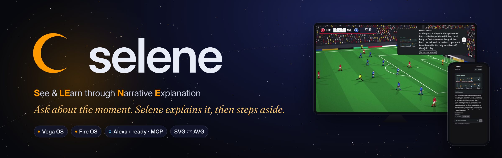
</p>

<div align="center">
  <h1>SELENE</h1>
  <p><strong>An AI viewing companion for Fire TV that explains the moment on screen, draws it live, and gets out of the way.</strong></p>
  <p><em>In Greek myth, Selene drove the moon across the night sky so no one watching would be lost in the dark.<br>Here she rides along with your film, your match, your show.</em></p>
  <p>
    <a href="submission/submission-description.md"></a>
    <a href="https://amazonappdev2026.devpost.com/"></a>
    <a href="https://selene-phone-demo-v2.yyaex8bhyrtby.us-east-1.cs.amazonlightsail.com/"></a>
  </p>
  <p>
    <a href="LICENSE"></a>
    
    
    
    
    
  </p>
  <p>
    
    
    
    
    
    
    
    
  </p>
  <p>
    <a href="submission/submission-description.md">Submission</a> ·
    <a href="submission/assets/selene-moment-loop.gif">The Selene moment</a> ·
    <a href="submission/assets/selene-architecture.gif">Architecture</a> ·
    <a href="submission/technical-notes.md">Technical notes</a> ·
    <a href="DESIGN.md">Design contract</a>
  </p>
  <p><sub>Ask about the moment → Selene reads only that moment → draws it as SVG or AVG → steps aside</sub></p>
</div>

> [!IMPORTANT]
> Selene runs on Vega OS and Fire OS today, with a paired phone. Its Alexa+ experience is **simulated inside the app** over the same MCP skills a real Alexa+ add-on would call; it is not a live Alexa+ integration. Selene overlays its own player; drawing over other providers' apps is not exposed by the Vega or Fire OS SDKs today (see [Truth boundaries](#truth-boundaries)). Playback keeps going unless the viewer says otherwise.

<details>
<summary><kbd>Contents</kbd></summary>

- [At a glance](#-at-a-glance)
- [The problem](#the-problem)
- [The Selene moment](#the-selene-moment)
- [See the product](#see-the-product)
- [Eight things Selene does](#eight-things-selene-does)
- [What the agent sees](#what-the-agent-sees)
- [One answer, two renderers: SVG and AVG](#one-answer-two-renderers-svg-and-avg)
- [The agent behind every answer, and Alexa+](#the-agent-behind-every-answer-and-alexa)
- [How the system is built](#how-the-system-is-built)
- [Try the demo](#try-the-demo)
- [Run locally](#-run-locally)
- [Verify](#verify)
- [Truth boundaries](#truth-boundaries)
- [Repository map](#repository-map)
- [License and attribution](#license-and-attribution)

</details>

## 🌙 At a glance

<table>
  <tr>
    <td width="25%" align="center"><strong>01 / ASK</strong><br><br>Voice, D-pad, or the paired phone. “What is offside?” “Who is Alisson?” “What did I miss?”</td>
    <td width="25%" align="center"><strong>02 / READ</strong><br><br>Only the sampled moment: completed captions, frames around it, the film’s own graph.</td>
    <td width="25%" align="center"><strong>03 / DRAW</strong><br><br>One Moment Response with a free-form animated diagram: SVG on Fire TV, AVG for Alexa.</td>
    <td width="25%" align="center"><strong>04 / STEP ASIDE</strong><br><br>Placed where nothing important is happening, or sent to your phone. The film never stops.</td>
  </tr>
</table>

<p align="center"><sub>One TV. Many viewers. Different needs. Selene answers each of them without costing the room the moment.</sub></p>

## The problem

A living room watches one screen, but nobody watches it the same way. Grandpa wants to know why the goal was ruled out. A child wants to know who the man in the hood is. Mum stepped out for snacks and missed the twist.

Today every one of those questions costs everyone the moment: pause, rewind, or somebody disappears into a phone search while the scene plays on. Chat assistants make it worse. They answer in paragraphs, they know nothing about *this* frame, and they cheerfully spoil what comes next.

Selene asks a narrower question:

> Can one question about the moment on screen get a clear, visual, spoiler-safe answer without anyone pausing the film?

## The Selene moment

<p align="center">
  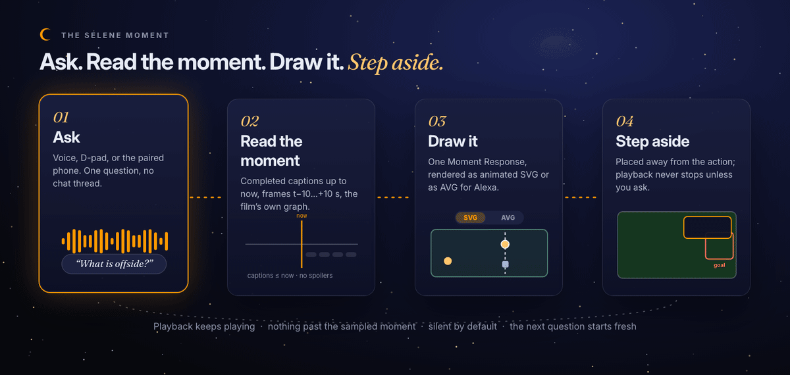
</p>

| Stage | What happens | What cannot happen silently |
| --- | --- | --- |
| **Ask** | A viewer asks by voice, D-pad, or the paired phone. Dialogue or scene detail can ride along in the same question. | No persistent chat thread; the next question starts fresh. |
| **Read the moment** | The relay freezes the sampled time and gathers completed captions, source frames from t−10 s (and up to t+10 s when the video already has them), and the film’s caption-backed graph. | Future dialogue is never sent; provider metadata alone is not scene evidence. |
| **Draw it** | The agent returns one Moment Response: a short answer, an animated diagram, a playback policy, and a follow-up. Headless Chromium renders it and the model may revise it up to twice. | An invalid or unsafe SVG is rejected and falls back to words. |
| **Step aside** | Local YOLOX-Nano finds the quiet corner; uncertain analysis keeps the answer outside the video. Or the answer goes to the phone instead. | Playback keeps going unless the viewer confirms otherwise. |

## See the product

Every screenshot below is a frame from a screen recording of the real app: the Vega OS build in the Vega Virtual Device and the paired phone page. The illustrated films are the two authored demo titles, **Football Match** and **The Missing Crown**.

<p align="center">
  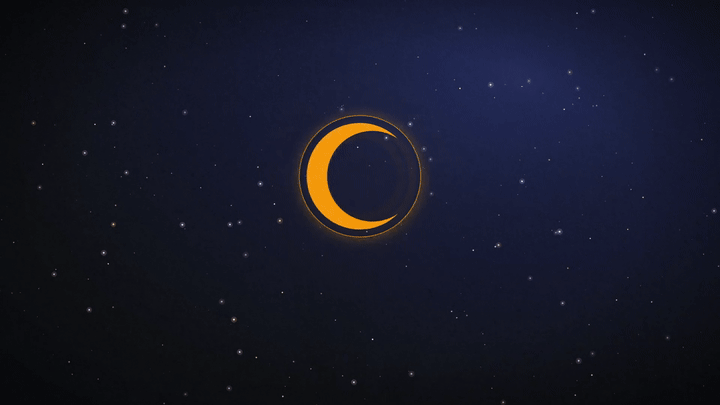
</p>

### On the TV

| Watch with Selene | Ask about this moment | One answer, drawn |
| --- | --- | --- |
| 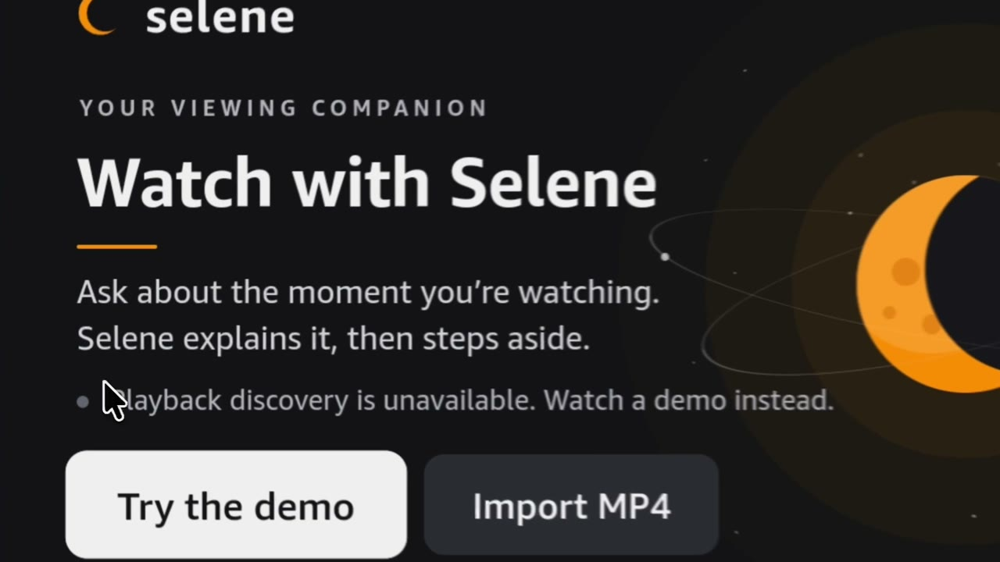 | 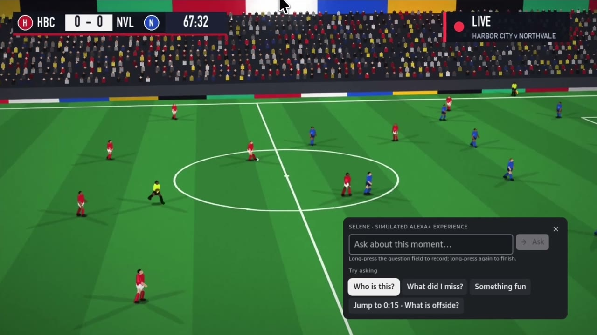 | 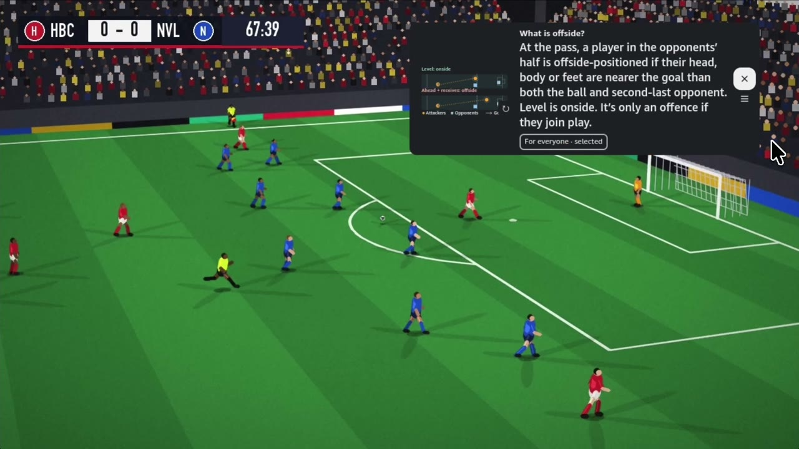 |
| The companion opens straight into one question about the playing title. | Suggestions come from this exact moment; prepared examples say when they apply. | Plain words plus a free-form diagram, with a `For everyone · selected` badge. |

| Moves out of the way | Steps aside for the shot | Explains after the goal |
| --- | --- | --- |
| 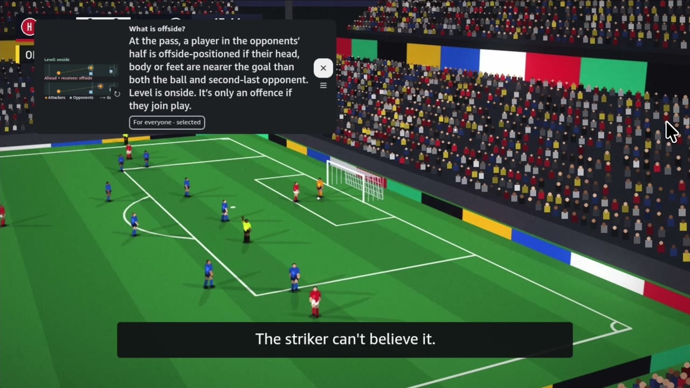 | 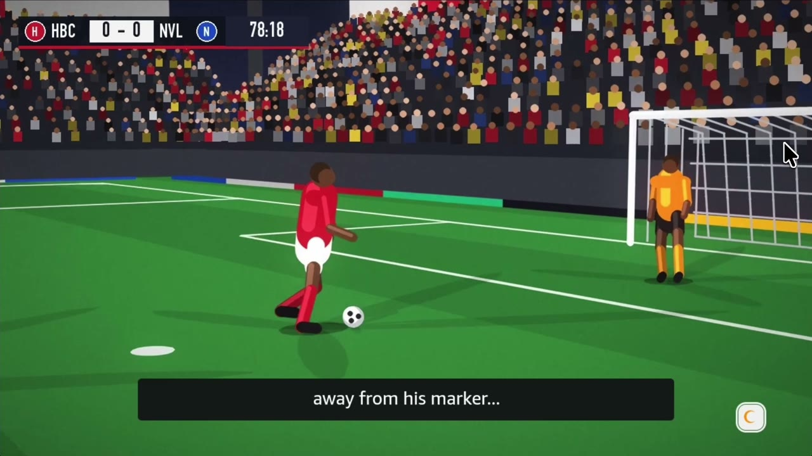 | 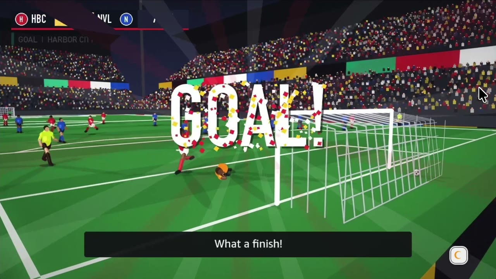 |
| The goal mouth entered top-right, so the panel moved top-left. | During the critical moment only a small crescent stays on screen. | Nothing covers the celebration; the explanation can resume afterwards. |

| The Missing Crown | Who is Alisson? | Watch together |
| --- | --- | --- |
| 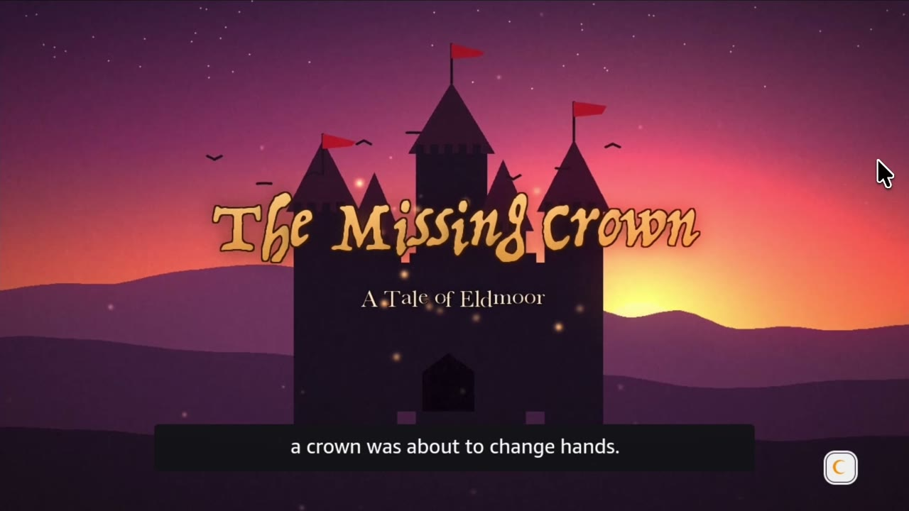 | 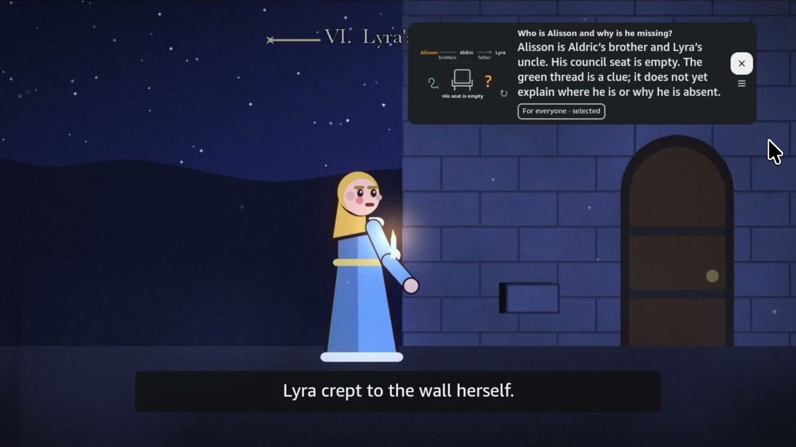 | 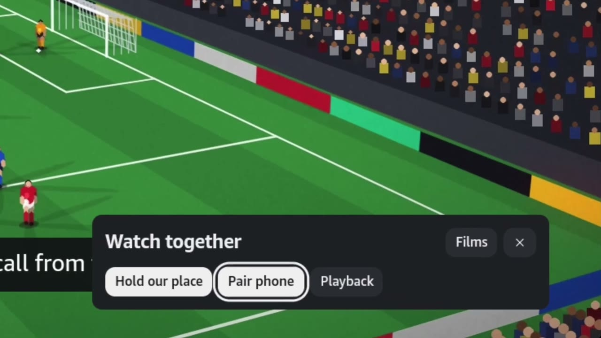 |
| A 2-minute animated film with a mystery, built for a child-friendly demo. | “Aldric’s brother and Lyra’s uncle. His seat is empty.” No invented reason. | Hold our place, pair a phone, or open playback controls. |

### On the paired phone

| Ask | For a grandparent | For a child | Follows the story | Something to talk about |
| --- | --- | --- | --- | --- |
| 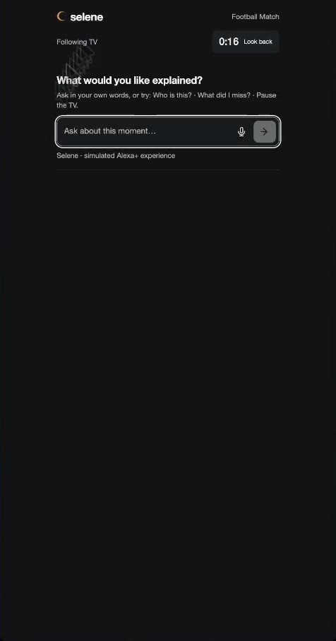 | 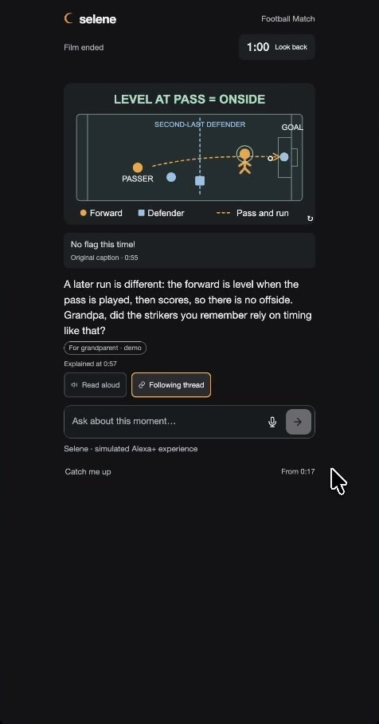 | 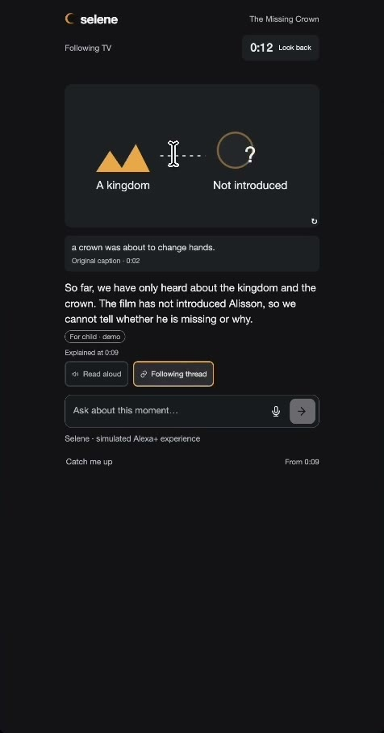 | 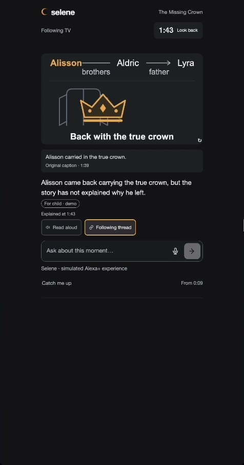 | 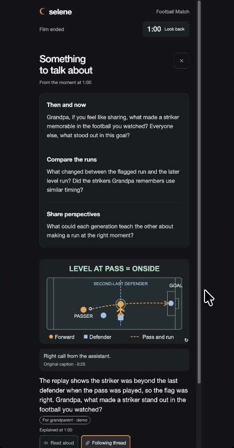 |
| Type or speak; the film stays on the TV. | Same rule, different words. | Visual first, familiar language. | The diagram grows with the film on its own. | Invitations for the family to talk, not to keep scrolling. |

## Eight things Selene does

| | Capability | What the viewer gets | How it is built |
| --- | --- | --- | --- |
| 🎨 | **Explanations drawn live** | A free-form animated diagram drawn for this moment, never a template. | Model-generated SVG animated with the native Web Animations API (WAAPI, no animation library), validated, rendered in headless Chromium, revised from real pixels (≤ 2 turns). |
| 🔁 | **SVG and AVG** | The same answer on Fire TV and on Alexa surfaces. | `server/visual-avg.mjs` converts geometry, labels and animation to AVG 1.2 / APL 2024.3, animated natively with APL `AnimateItem`; the official APL viewhost runs locally. |
| 🎯 | **Smart placement** | Answers never cover the ball, the goal mouth, faces, captions or the score. | Local YOLOX-Nano ONNX + edge/contrast/motion scoring, sampled now and every 2 s for 10 s; uncertain → outside the video. |
| 📱 | **Second screen** | Rather keep the TV clear? Send every answer to your phone. | Six-digit single-use pairing, token-scoped private routes, a private SVG explainer on the phone. |
| 🗣️ | **Personal by voice and text** | “I’m grandma, explain simply” changes the words, not the facts. | Stated role or consented local ECAPA voice match → communication preferences; never an inferred age. |
| 🧵 | **Follow thread** | The diagram grows with the story automatically. No clicks. | Reviewed, spoiler-bounded updates to the same SVG card at material developments. |
| ⏪ | **Catch me up** | “What did I miss?” recaps the gap and never what comes next. | The tap freezes the TV sample; the recap covers that interval only. |
| 💬 | **Selene invites conversation** | “Grandpa, what made a striker memorable in the football you watched?” | A scheduled conversation agent rereads captions and context, then may quietly offer two or three invitations. |

<table>
  <tr>
    <td width="50%">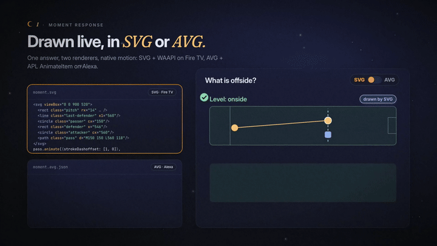<br><sub><strong>I · Drawn live, in SVG or AVG.</strong> Native motion on both: WAAPI on Fire TV, APL AnimateItem on Alexa. Each row is tagged with the renderer that drew it.</sub></td>
    <td width="50%">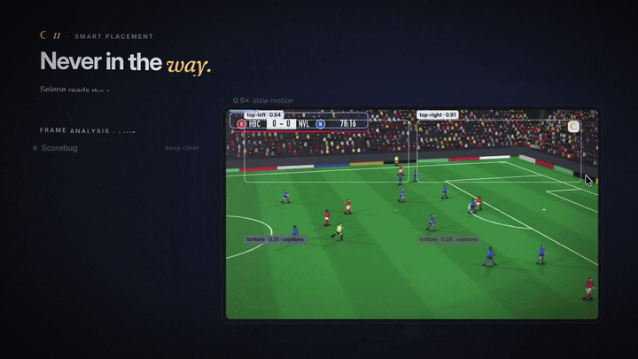<br><sub><strong>II · Never in the way.</strong> The real recording at 0.5× while the panel is re-placed.</sub></td>
  </tr>
  <tr>
    <td width="50%">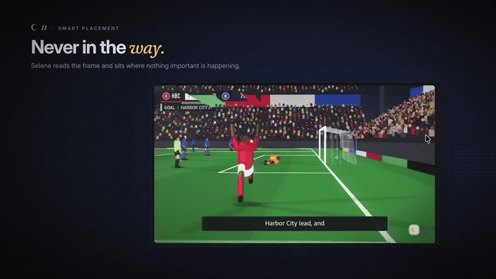<br><sub><strong>Second screen.</strong> The TV keeps only a quiet crescent.</sub></td>
    <td width="50%">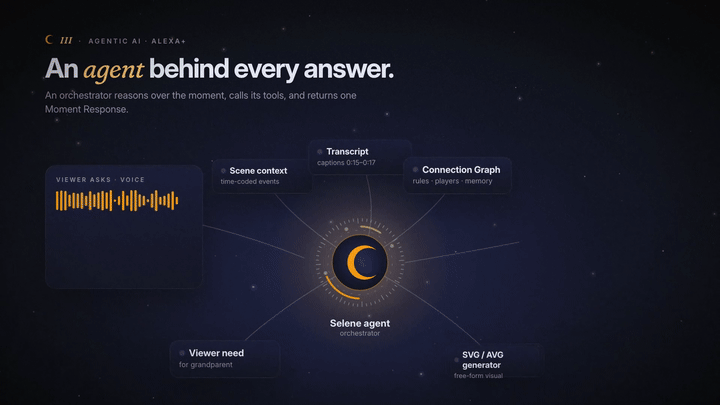<br><sub><strong>III · An agent behind every answer.</strong> Tools in, one Moment Response out.</sub></td>
  </tr>
  <tr>
    <td width="50%">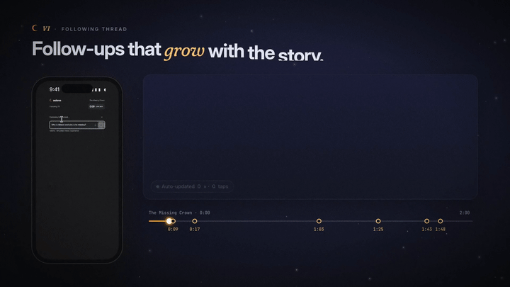<br><sub><strong>VI · Follow-ups that grow with the story.</strong> Auto-updated, zero taps.</sub></td>
    <td width="50%">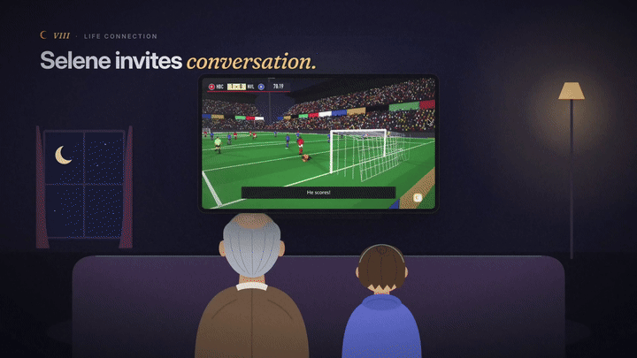<br><sub><strong>VIII · Selene invites conversation.</strong> AI opens the door; family walks through it.</sub></td>
  </tr>
</table>

## What the agent sees

<p align="center">
  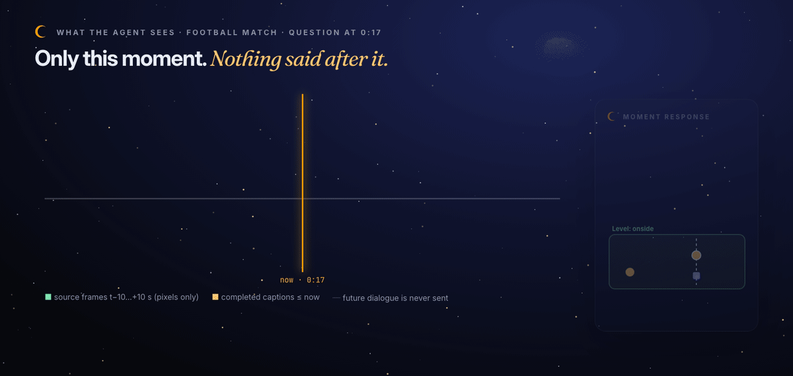
</p>

<p align="center"><sub>Real frames and captions from Football Match. The question is asked at 0:17; the caption “Let’s see it again.” at 0:18 is never sent.</sub></p>

| Evidence | Sent to the model | Why |
| --- | --- | --- |
| Completed captions | Every cue finished by the frozen question time | Grounds who said what without leaking later dialogue. |
| Source frames | JPEGs at t −10, −8, −6, −4, −2 s, plus +2, +4, +6, +8, +10 s **only when the video already contains those ten seconds** (recorded or imported titles). A live stream has no future frames, so only t −10…−2 s are used. | The lookahead lets the agent see the action resolve on recorded video, never future plot. |
| Film graph | Caption-backed nodes and edges for this film only | “striker”, “last defender”, “Alisson → brother of → Aldric”. No cross-title memory. |
| Viewer request | The question, optional scene detail, explicit communication needs | “I’m a kid” shapes the words; it is never an identity claim. |
| Not sent | Raw image bytes in logs, family conversation, profile IDs, embeddings, ages | Questions and conversations are not persisted to disk. |

## One answer, two renderers: SVG and AVG

Selene treats a Moment Response as data, not a picture. The same validated answer renders as **animated SVG** on the Vega and Fire OS apps and the phone, and as **Alexa Vector Graphics** for Alexa surfaces. Switching renderer never generates a second answer.

Motion is native on both sides, with no animation library and no video: the browser's **Web Animations API (WAAPI)** animates the SVG, and the same keyframes become AVG parameters driven by the APL **`AnimateItem`** command. Reduced motion turns both off.

<table>
  <tr>
    <th width="50%">SVG · Fire TV (Vega OS)</th>
    <th width="50%">AVG · Alexa (APL 2024.3)</th>
  </tr>
  <tr>
    <td>

```html
<svg viewBox="0 0 900 520">
  <rect class="pitch" rx="14" … />
  <line class="last-defender" x1="560" />
  <circle class="attacker" cx="560" />
  <path class="pass" d="M150 150 L560 118" />
</svg>
pass.animate({ strokeDashoffset: [1, 0] },
  { duration: 900, easing: 'ease-out' })
```

</td>
    <td>

```json
{ "type": "AVG", "version": "1.2",
  "width": 900, "height": 520,
  "items": [
    { "type": "path", "pathData": "M40 306h820v170H40z" },
    { "type": "path", "pathData": "M560 316v150",
      "strokeDashArray": [8, 8] },
    { "type": "path", "pathData": "M150 400 L660 354" }
  ] }
```

</td>
  </tr>
</table>

- Each WAAPI animation maps to one AVG parameter and one `AnimateItem` command; transform and opacity keyframes become AVG expressions.
- Unsupported SVG semantics report an error instead of silently dropping content.
- The official `apl-viewhost-web@2024.3.0` WASM runtime runs locally in an opaque-origin, script-only iframe with network access blocked; its bytes are pinned by SHA-256 at build time.
- Diagrams are free-form: the same canvas that draws an offside line also draws a family tree with an empty chair.

## The agent behind every answer, and Alexa+

Selene's agent is a coordinator inside a tight boundary. The model interprets and generates; host code enforces playback state, consent, evidence windows and renderer safety.

| Skill (MCP, spec 2025-11-25) | What it does | Boundary |
| --- | --- | --- |
| `get_viewing_context` | Title, position and play state of the current session. | Read-only; the TV position is the spoiler boundary. |
| `explain_moment` | The full Moment Response pipeline above. | Only the sampled moment; validated SVG or words. |
| `catch_me_up` | Recap of a missed interval. | Ends at the captured tap time; never what comes next. |
| `who_is_on_screen` | Characters or roles in the scene. | Only what captions and the film graph establish. |
| `trivia` | Authored, safe-after facts. | Each item carries a `safe_after` time. |
| `control_playback` | Pause, play, go back. | A claim of pause or play needs a provider result. |

Inside the app, an **Alexa+ look-alike** built on Selene's own AI agent simulates the Alexa+ experience. Its orchestrator is a real MCP client: it routes a request to these skills by model tool choice, keeps the last six turns, and labels itself *“Selene · simulated Alexa+ experience”*. When Alexa+ add-on access opens, the same MCP server is the integration point. Design details are in the [technical notes](submission/technical-notes.md).

## How the system is built

<p align="center">
  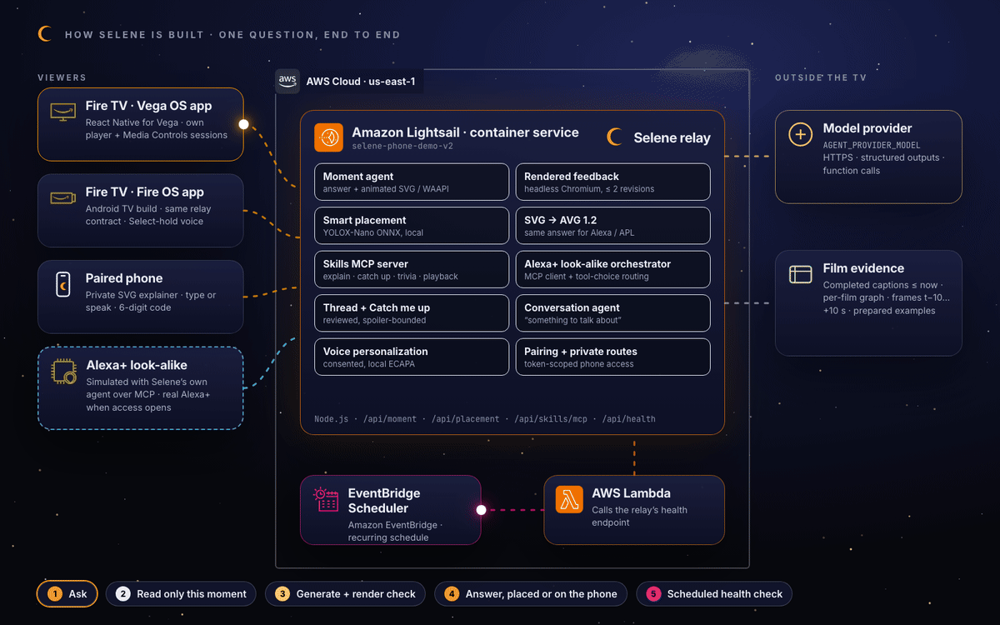
</p>

| Layer | Responsibility |
| --- | --- |
| [`src/`](src/) | Vega OS app: React Native for Vega, Media Controls session discovery, own player, voice capture, native SVG motion. |
| [`fireos/`](fireos/) | Fire OS (Android TV) build of the same experience and relay contract. |
| [`web/`](web/) | WebView answer surface, paired-phone private mirror, SVG and AVG renderers, APL runtime host. |
| [`server/`](server/) | Node relay: moment agent, placement, SVG→AVG, skills MCP server, Alexa+ look-alike orchestrator, conversation scheduler, voice, pairing. |
| [`content/`](content/) | Catalog packages: captions, facts, per-film caption graph, prepared-example bindings. |
| [`shared/`](shared/) | Visual transform math shared by native and web renderers. |
| [`infra/aws/`](infra/aws/) | CloudFormation for the EventBridge Scheduler → Lambda wake-up that calls `POST /api/wake`. |
| [`scripts/`](scripts/) | Build, ingest, Vega VVD launch, automation, live checks, phone-contract check. |
| [`test/`](test/) | Node and native test suites, fixture catalog, live-model checks. |

The relay reads `AGENT_PROVIDER_URL`, `AGENT_PROVIDER_MODEL` and `AGENT_PROVIDER_API_KEY` from `../.env` and calls the provider over HTTPS with strict structured outputs and function calls. Credentials never enter the TV bundle or the Chromium process. The relay runs as the Amazon Lightsail container service `selene-phone-demo-v2` in `us-east-1`. Follow thread and the “Something to talk about” agent also need to act later without a tap. Amazon EventBridge Scheduler invokes the `selene-wake` AWS Lambda function, which calls the relay’s token-protected `POST /api/wake`; the relay re-runs any due thread or conversation check through the same logic, so updates still arrive when the phone browser is asleep or a container restart dropped an in-process timer. The stack is defined in [`infra/aws/`](infra/aws/) and is ready to deploy.

## Try the demo

1. Launch Selene on the Vega Virtual Device (or Fire OS) and choose **Try the demo**.
2. **Football Match** → open **Ask Selene** → “What is offside?” Watch the panel move off the goal mouth and step aside for the shot.
3. Choose **Watch together → Pair phone** and enter the six-digit code on your phone.
4. On the phone, say or type “Explain it for my grandpa.” Then try “Who is Alisson?” on **The Missing Crown** with “I’m a kid.”
5. Turn on **Follow thread** and keep watching: the diagram updates by itself at 0:17, 1:03, 1:25, 1:43 and 1:48.
6. Step away, come back, tap **Catch me up**.
7. Let the film end and look for **Something to talk about**.

## ⚡ Run locally

Requirements: the Vega SDK with its Virtual Device, Node.js 22, FFmpeg/FFprobe, Chrome or Chromium, and provider credentials in `../.env`. The two demo MP4s are excluded from Git; place permitted copies at `assets/media/football-match/video.mp4` and `assets/media/the-missing-crown/video.mp4`.

```sh
npm ci
npm run build          # web + native assets
npm start              # the relay
```

In another terminal:

```sh
npm run vega:manual    # starts the 1280×720 VDA, installs the Debug package, launches Selene
```

Pair a phone against the deployed relay instead of a local tunnel:

```sh
SELENE_APP_URL=https://selene-phone-demo-v2.yyaex8bhyrtby.us-east-1.cs.amazonlightsail.com npm run build:web
npm run build:debug
npm run vega:manual:phone
```

Optional voice personalization: `bash scripts/setup-voice.sh` installs the pinned local ECAPA worker. Full configuration lives in the [technical notes](submission/technical-notes.md#build-and-run).

## Verify

```sh
npm run typecheck
npm run lint
npm test
npm run build
npm run test:live                       # real model: explanation, spoiler boundary, translation
npm run test:live -- --visual-quality   # five cross-intent real-model diagrams
npm run vega:automation -- --feature football-match
```

The latest local record lists 193 Node tests and 25 native Jest tests passing, with Vega/web and Fire OS TypeScript checks and the web build. The [technical notes](submission/technical-notes.md) keep the dated record of what was exercised on the VDA, the Android TV emulator and the phone. Passing schema and runtime checks is not proof of teaching quality.

## Truth boundaries

- **Alexa+ is a look-alike.** We simulate the Alexa+ experience with Selene's own AI agent; the in-app orchestrator uses real MCP calls to Selene's own skills. No live Alexa+, wake word, Alexa voice or Amazon branding is used.
- **Overlay on other apps is an SDK limit, not a design choice.** We designed Selene to be a true overlay that floats over whatever is playing. Today the Vega SDK and Fire OS documentation expose no API, permission or capability that lets a third-party app draw over another provider's player (such as Prime Video), and we found no supported overlay privilege to request. So Selene overlays its own player only, and for other apps it works as a companion: Media Controls session discovery on the TV and the paired phone as a second screen. If an overlay capability opens, the same placement engine is ready to use it. Without an authorized scene-context feed, the companion works from session metadata plus what the viewer types.
- **Only the sampled moment.** Captions stop at the question time. On recorded video, frames after it give up to ten seconds of visual lookahead; a live stream has no future frames, so Selene uses the ten seconds before the question only. Never future dialogue or plot.
- **Personalization is stated, not guessed.** Roles come from the viewer's words, an explicit preference, or a consented local voice match. Age or family role never implies disability or low literacy.
- **Placement can be wrong.** Sparse samples and a general object detector can miss subjects; uncertain or slow analysis keeps the answer outside the video.
- **Device coverage.** Builds, VDA runs and emulator runs are recorded in the technical notes. Physical Fire TV and physical Vega hardware remain unverified for several paths.
- **Demo content.** Both demo films are authored for this project. Prepared examples are labelled, title-matched and source-checked; ordinary questions invoke the real agent.

## Repository map

| Path | Purpose |
| --- | --- |
| [`PRODUCT.md`](PRODUCT.md) | Current product decisions, users, brand commitments and boundaries. |
| [`DESIGN.md`](DESIGN.md) | Fire TV visual language, focus states, spacing and the original orange crescent mark. |
| [`submission/submission-description.md`](submission/submission-description.md) | Devpost-ready project narrative. |
| [`submission/technical-notes.md`](submission/technical-notes.md) | Detailed implementation and dated verification history (the previous README). |
| [`submission/assets/`](submission/assets/) | README banner, animated diagrams, launch-film GIFs and their generator. |
| [`submission/screenshots/`](submission/screenshots/) | Product frames from the Vega and phone screen recordings. |

## License and attribution

Selene source code is licensed under [Apache-2.0](LICENSE).

- The banner and animated diagrams are original repository assets generated from [`submission/assets/src/readme-art.html`](submission/assets/src/readme-art.html) by [`submission/assets/generate-readme-assets.py`](submission/assets/generate-readme-assets.py). They use the real Selene mark from [`assets/selene-mark.svg`](assets/selene-mark.svg) and the Inter, Fraunces and JetBrains Mono fonts (SIL Open Font License).
- The `film-*.gif` excerpts come from Selene's own launch film; its score is original and was rendered with the MIT-licensed MuseScore General soundfont.
- Screenshots are frames from screen recordings of the Selene app running the two authored demo films.
- [YOLOX-Nano](https://github.com/Megvii-BaseDetection/YOLOX) is Apache-2.0 (`server/models/YOLOX-LICENSE`). The APL viewhost runtime ships with its official LICENSE, NOTICE and THIRD-PARTY files.
- Selene is an independent app. Amazon, Fire TV, Vega, Alexa and Prime Video are trademarks of Amazon.com, Inc. or its affiliates; no affiliation or endorsement is implied.
